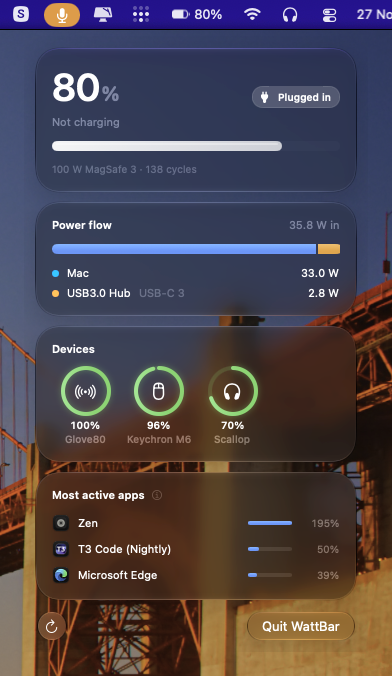

# WattBar

A small native macOS menu-bar app for your Mac's battery and the batteries of your wireless devices.

<p align="center">
  
</p>

The menu bar shows the battery icon and percentage. Click it to open the panel:

- **Battery:** percentage, charging state, time to full, adapter, cycle count.
- **Power flow:** measured watts in, and how they split between the Mac and powered USB-C devices.
- **Devices:** a battery ring for each wireless keyboard, mouse, headset or AirPods. Hover a Bluetooth device and click the x, or right-click it, to disconnect it.
- **Most active apps:** the three apps using the most CPU.

WattBar also sends a notification when a device drops to the level macOS warns at (usually 20%).

The panel uses Liquid Glass on macOS 26 or newer. It runs on macOS 14 or newer.

## Install or update

Run this in Terminal:

```zsh
curl --proto '=https' --tlsv1.2 -fsSL https://github.com/namdien177/WattBar/raw/refs/heads/main/Scripts/install.sh | zsh
```

The installer always downloads the latest `main`, builds a release app, installs it to `~/Applications/WattBar.app`, restarts WattBar, and removes the downloaded source and Swift build cache afterward. It verifies macOS 14+, Swift 6+, and code signing. If Xcode Command Line Tools are missing, it opens Apple's installer and tells you when to rerun the command.

Run the same command again to update.

## Install with an AI agent

Paste this to any coding agent that can run shell commands on your Mac (Claude Code, Codex, Cursor and similar):

```text
Install WattBar on this Mac by following the "Agent instructions" section of
https://github.com/namdien177/WattBar/blob/main/README.md
```

### Agent instructions

These steps are for an AI agent installing WattBar for a user. Run them on the user's Mac, in order. Do not clone the repo; the installer downloads and builds the source itself.

1. **Check the machine.** Run `sw_vers -productVersion` and `uname -m`. Stop and tell the user if the major version is below 14.
2. **Check the build tools.** Run `xcrun swift --version`. If it fails, run `xcode-select --install`, then stop and ask the user to finish Apple's installer window and tell you when it is done. You cannot click through that window for them.
3. **Install.** Run:

   ```zsh
   curl --proto '=https' --tlsv1.2 -fsSL https://github.com/namdien177/WattBar/raw/refs/heads/main/Scripts/install.sh | zsh
   ```

   The build takes one to three minutes. It ends with `Installed and launched:` followed by the app path. If it fails, show the user the last 20 lines of output and stop.
4. **Verify.** All three must pass:
   - `test -d ~/Applications/WattBar.app && echo ok`
   - `codesign --verify --deep --strict ~/Applications/WattBar.app && echo ok`
   - `pgrep -x WattBar` prints a process id.
5. **Ask before starting at login.** Ask the user if WattBar should open at login. Only if they agree, run:

   ```zsh
   osascript -e 'tell application "System Events" to make login item at end with properties {path:(POSIX path of (path to home folder)) & "Applications/WattBar.app", hidden:false}'
   ```

   macOS may ask them to allow your terminal to control System Events. If they decline, tell them to add it under **System Settings > General > Login Items** instead.
6. **Tell the user** that:
   - The battery percentage is now in the menu bar; click it to open the panel.
   - If the menu bar is full, the icon may be hidden behind the notch or a menu-bar manager.
   - macOS asks for Bluetooth access the first time they disconnect a device. Nothing else needs a permission.
   - Running the install command again updates WattBar.

To uninstall, run:

```zsh
osascript -e 'quit app "WattBar"'
rm -rf ~/Applications/WattBar.app
```

Then remove WattBar from **System Settings > General > Login Items** if it was added.

## Build manually

Requirements: macOS 14 or newer and Swift 6 from Xcode or Xcode Command Line Tools.

```sh
chmod +x Scripts/build-app.sh
Scripts/build-app.sh
open dist/WattBar.app
```

Swift Package Manager handles dependencies automatically; WattBar currently has no third-party packages.

The app icon lives in `Resources/AppIcon.png` (1024x1024, SVG source in `Resources/AppIcon.svg`). After changing it, run `Scripts/make-icon.sh` to regenerate `Resources/AppIcon.icns`.

The app is local-only. macOS asks for Bluetooth access the first time you disconnect a device; nothing else needs a permission.

## Efficiency

- Battery data comes directly from IOKit; no shell process is used for routine battery updates.
- The menu-bar summary refreshes every 30 seconds with a five-second timer tolerance.
- Device names and app activity are sampled only while the panel is open, once every 30 seconds.
- Wireless device batteries come from the same in-process source `pmset -g accps` uses, read every 30 seconds (every 10 while the panel is open) so low-battery alerts arrive with the panel closed. That source is not a public API; if a future macOS removes it, the Devices section hides.
- On supported Apple Silicon Macs, WattBar reads actual adapter input, signed battery flow, Mac consumption, and per-port USB-C output from power telemetry.
- Undocumented detailed telemetry may be unavailable on other hardware or future macOS versions; WattBar falls back to battery voltage and current.
- Per-app wattage is not available through a public macOS API, so app activity is ranked using aggregate CPU usage as a transparent power proxy.
